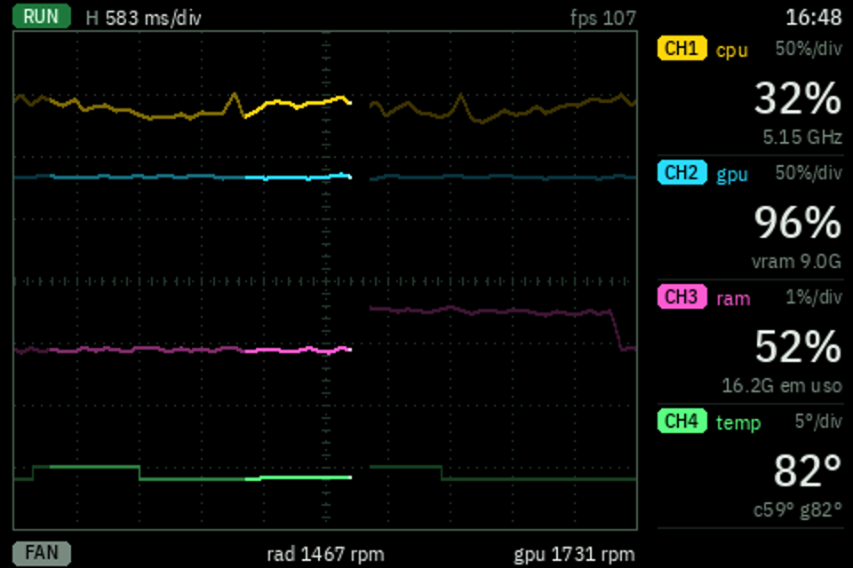
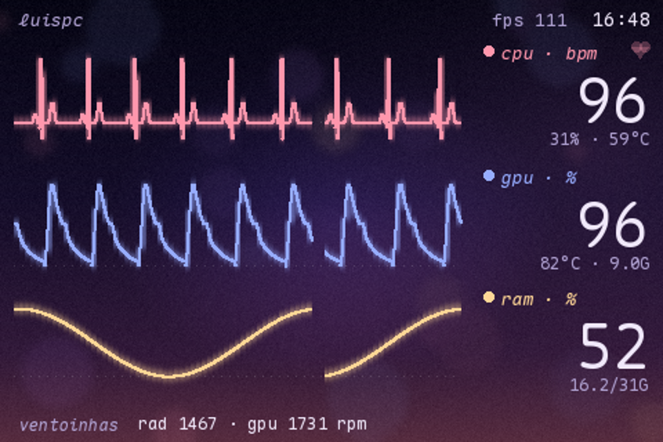
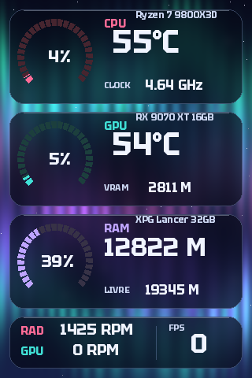
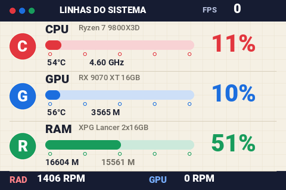
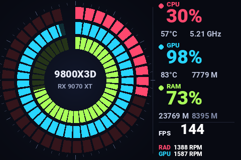
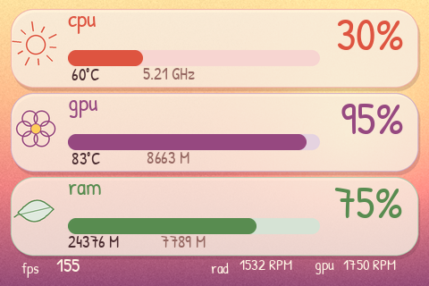
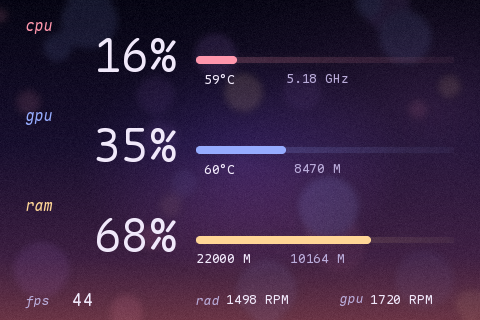
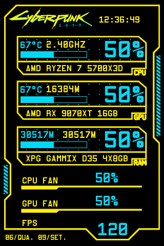

# Telinha do Luis: osciloscópio, monitor de UTI e temas

> Baseado no [turing-smart-screen-python](https://github.com/mathoudebine/turing-smart-screen-python) de Matthieu Houdebine. Documentação do projeto original: [README-original.md](README-original.md).

Fork do [turing-smart-screen-python](https://github.com/mathoudebine/turing-smart-screen-python) usado numa tela
**TURZX 3.5" (revisão A, "UsbMonitor", USB `1A86:5722`)**, num PC com Ryzen 7 9800X3D, Radeon RX 9070 XT e placa-mãe
MSI X870E. Traz dois modos animados novos, temas, correções no driver da revisão A e o que aprendemos sobre o protocolo
dessa tela.

| Osciloscópio (`osciloscopio.py`) | Monitor de UTI (`vitais.py`) |
|---|---|
|  |  |

*Imagens geradas pelo modo `--preview`, com valores simulados parecidos com uma partida de Arc Raiders (as leituras
reais exigem a tela e administrador).*

## Modos animados

### `osciloscopio.py`: osciloscópio de fósforo, 4 canais

Cada traço é o sinal medido ao longo do tempo, com retícula de 10 x 8 divisões, base de tempo (`H 583 ms/div`) e
rastro de fósforo que esmaece em 4 tons.

| Canal | Sinal | Leituras | Escala |
|---|---|---|---|
| CH1 cpu | carga da CPU (psutil) | 10/s | 50 %/div |
| CH2 gpu | carga do motor 3D (contador "GPU Engine" do Windows, o mesmo do Gerenciador de Tarefas) | 10/s | 50 %/div |
| CH3 ram | memória em uso | 10/s | 1 %/div em volta da média recente (acoplamento AC) |
| CH4 temp | a mais quente entre CPU Tctl e hot spot da GPU | 1/s | 5 °C/div em volta da média recente |

Os traços são desenhados com o **comando 195** (pixels soltos, ver abaixo): só os pixels que mudam vão para a tela.
Roda a 30 quadros/s usando ~25 % da banda da tela. O painel mostra os valores e a barra de baixo, as ventoinhas.

### `vitais.py`: monitor de UTI enevoado

ECG = CPU (frequência cardíaca = 55 + 1,25 x carga), pleth = GPU (amplitude = carga), respiração = RAM, sobre o
fundo do tema `fade-luis`. Desenhado por faixas de bitmap, 15 quadros/s.

Nos dois modos, leitura ausente vira `--` e traço reto cinza: **nunca um valor inventado ou congelado**. Alarme em
vermelho acima de 90 °C (CPU) ou 100 °C (hot spot da GPU).

### Sensores e FPS

- **LibreHardwareMonitor** (já incluso em `external/`, com o driver PawnIO): CPU Tctl, hot spot da GPU, VRAM,
  ventoinhas da placa-mãe (inclusive bomba do water cooler). Precisa de **administrador**; sem admin o LHM devolve
  Tctl 0,0 e nenhum sensor da placa, então os modos recusam usá-lo e caem para o HWiNFO.
- **PresentMon** (Intel, ETW, sem injeção no jogo): FPS do app em primeiro plano, com "memória" do último app que
  entregava quadros (ex.: um app auxiliar por cima do jogo). Baixe o executável, ver
  [`external/PresentMon/LEIA-ME.md`](external/PresentMon/LEIA-ME.md).
- **HWiNFO** (opcional, modo reserva sem admin): `HW_SENSORS: HWINFO` lê o "Gadget" do HWiNFO pelo registro
  (`library/sensors/sensors_hwinfo.py`). Ao fechar, o HWiNFO deixa os últimos valores no registro; por isso o
  processo dele é checado antes de ler.

## Instalação (Windows)

```bat
python -m venv .venv
.venv\Scripts\pip install -r requirements.txt
```

1. Instale o PawnIO (`external\PawnIO\PawnIO_setup.exe`) e baixe o PresentMon para `external\PresentMon\`.
2. Ajuste `COM_PORT` e `BRIGHTNESS` no `config.yaml` (as seções `vitais:` e `osciloscopio:` têm FPS e banda).
3. Teste sem a tela: `.venv\Scripts\python osciloscopio.py --preview 8 --out preview.png` (o preview também confere
   os pacotes 195 numa tela virtual e imprime os pixels divergentes, que devem ser 0).
4. Rode como administrador: `.venv\Scripts\pythonw osciloscopio.py`. Para iniciar com o Windows, uma tarefa
   agendada no logon com "Executar com privilégios mais altos".

Os temas continuam rodando pelo `main.py` como no projeto original.

## Temas

| aurora-luis | metro-luis | aneis-luis |
|---|---|---|
|  |  |  |

| anything-luis | fade-luis | Cyberpunk-Luis |
|---|---|---|
|  |  |  |

Os fundos são gerados por código (`gerar_fundo.py` em cada pasta). Também há `taiko-luis`. Fontes novas em
`res/fonts/` (IBM Plex Sans Condensed, Maple Mono, Patrick Hand, Tektur, M PLUS Rounded 1c), todas OFL, com as licenças.

## Mudanças na biblioteca

| Arquivo | Mudança |
|---|---|
| `library/lcd/lcd_comm_rev_a.py` | `Resync()` antes do reset (zera a corrupção depois de um programa morto no meio de uma imagem); imagens grandes em fatias com pausa configurável |
| `library/lcd/lcd_comm.py` | barras de progresso arredondadas; anéis radiais concêntricos que não se apagam; mais tentativas de abrir a porta e reinício ao reconectar |
| `library/display.py`, `config.yaml` | opções `SERIAL_SLICE_MAX_BYTES`, `SERIAL_SLICE_PAUSE_MS`, `SERIAL_RESYNC_BYTES`, seções `vitais` e `osciloscopio` |
| `library/sensors/sensors_hwinfo.py`, `stats.py`, `sensors_custom.py` | backend `HWINFO`; hot spot da GPU sem cair para a temperatura de borda |
| `library/sensors/sensors_librehardwaremonitor.py` | trava em volta do LHM (3 threads chamando `Update()` ao mesmo tempo deixavam a carga da CPU errada) |

## O que aprendemos sobre a tela (revisão A)

- **Só escrita.** A tela nunca responde (HELLO com 3 s de escuta: 0 bytes) e o app oficial (`UsbMonitor.exe`,
  TURZX 2.2.1) também nunca lê a porta. Não há ACK, versão de firmware nem leitura de volta.
- **Banda: 128.000 bytes/s cravados** (2 pacotes USB de 64 B por ms), igual com escrita de 512 B a 300 KB, baud
  115200/921600/2M e RTS/CTS ligado ou não. O limite é o firmware.
- **Comando 195 (`DISPLAY_PIXELS`) funciona nesta tela**, apesar de a biblioteca marcá-lo como "só da próxima
  geração". Formato, tirado do app oficial: pacote fixo de **64 bytes** = cabeçalho de 6 bytes (x, y = origem;
  `ex` = número de bytes de dados, até 56; `ey` = 0; comando 195) + **uma cor RGB565 big-endian** (2 bytes) + até
  **28 pares (dx, dy)** de 1 byte relativos à origem, resto zeros. Vazão medida: **1000 pacotes/s = 28.000 pixels/s**,
  sem perdas (bitmap: 64.000 px/s). Compensa quando muda menos de ~44 % da área retangular equivalente e em fundo
  liso (uma cor por pacote).
- **A causa da imagem corrompida**: um programa morto no meio de uma imagem (tarefa parada, desligar o PC) deixa a
  tela esperando o resto dos pixels; ela come o RESET do programa seguinte como pixel e a serial passa a perder blocos
  (`Too fast! Slow down!` no log, que a biblioteca original só registra e descarta). Reproduzido 3 de 3 vezes;
  mandar 307.200 bytes zero antes do reset resolveu (191 blocos perdidos sem, 0 com).
- **Sessões ETW órfãs**: matar o PresentMon (ou fechar o HWiNFO) deixa a sessão de rastreamento viva no Windows, e
  sessões órfãs acumuladas fizeram o PresentMon perder todos os eventos. `logman query -ets` lista,
  `logman stop <nome> -ets` encerra. O monitor usa sempre a mesma sessão ("telinha"), então não acumula.

## Licenças

Código sob GPL-3.0 como o projeto original. Fontes sob SIL OFL 1.1 (arquivos de licença em cada pasta).
O PresentMon (MIT, Intel) não é distribuído aqui.
